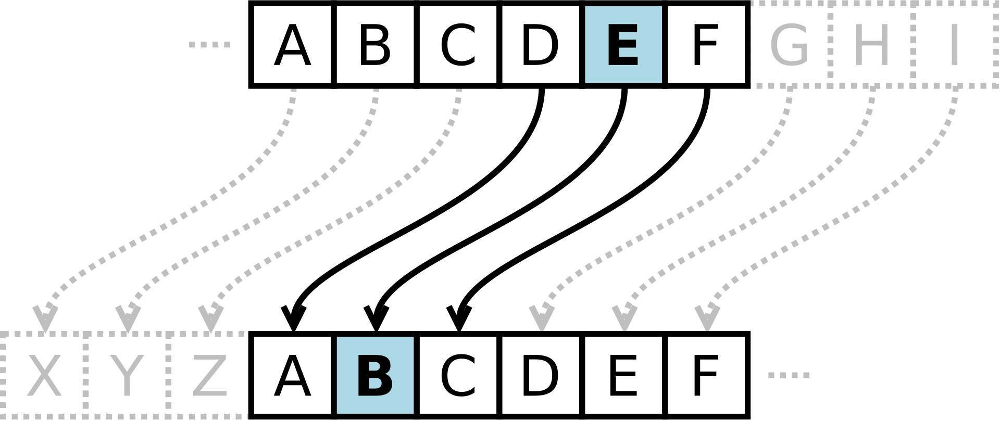

# Cifra de César

Um dos grandes comandantes militares que usou mensagens criptografadas foi Júlio César, por volta de 50 a.C. Ele usava uma cifra simples conhecida como cifra de César para proteger comunicações militares. Essa cifra também é chamada de cifra de deslocamento, porque cada letra do texto simples é substituída por uma letra situada a um número fixo de posições antes ou depois no alfabeto.

Por exemplo, se você escrever `NIKOLATESLA` e deslocar cada letra três posições para a esquerda:



```text
A B C D E F G H I J K L M N O P Q R S T U V W X Y Z
X Y Z A B C D E F G H I J K L M N O P Q R S T U V W
```

A letra `N` se torna `K`, `I` se torna `F`, e assim por diante. Portanto, cada letra é substituída por outra letra que está a uma determinada distância no alfabeto.

A **descriptografia** funciona da mesma maneira, mas ao contrário. Para descriptografar o texto cifrado, desloque cada letra três posições para a direita:

```text
A B C D E F G H I J K L M N O P Q R S T U V W X Y Z
D E F G H I J K L M N O P Q R S T U V W X Y Z A B C
```

A letra `K` se torna `N`, `F` se torna `I`, e assim por diante. O resultado desse deslocamento é a mensagem original descriptografada `NIKOLATESLA`.


## Tarefa para pensar

Pense em como você criaria um aplicativo de console em qualquer linguagem de programação que criptografe e descriptografe mensagens usando a cifra de César.

```{infonote}
O primeiro aluno (*piloto*) deve se concentrar na sintaxe enquanto digita o código para criptografar a mensagem. O segundo aluno (*navegador*) deve acompanhar o código, sugerir melhorias e fazer perguntas. Depois de criptografar, troquem os papéis para descriptografar.
```

O alfabeto permitido para mensagens (tanto para o texto simples quanto para o texto cifrado) pode conter apenas letras minúsculas do alfabeto inglês:

```text
Σ = { a, b, c, d, e, f, g, h, i, j, k, l, m, n, o, p, q, r, s, t, u, v, w, x, y, z }
```

Espaços, letras maiúsculas, números e outros caracteres não são permitidos.

Na primeira linha da entrada, há uma mensagem `m` com no máximo cem caracteres; na segunda linha, um número inteiro `n`, que representa o valor do deslocamento (1–25); e na terceira linha, um número inteiro `s`, que representa a direção da criptografia. Se `s=1`, então `m` deve ser criptografada; e se `s=2`, então `m` deve ser descriptografada.

### Exemplo de teste 1

Se a entrada for:

```text
nikolatesla
3
1
```

a saída deve ser:

```text
kfhlixqbpix
```

### Exemplo de teste 2

Se a entrada for:

```text
kfhlixqbpix
3
2
```

a saída deve ser:

```text
nikolatesla
```

## Dicas de solução

Como o alfabeto inglês tem 26 letras, a posição de cada letra pode ser representada por um número de 0 a 25.

* a → 0
* b → 1
* c → 2
* ...
* z → 25

Para **criptografar** uma letra, você pode usar a seguinte fórmula:

```text
new_letter_position = (current_letter_position - shift_value + 26) mod 26
```

`current_letter_position` representa o valor numérico da letra no alfabeto, `shift_value` representa o número de posições do deslocamento (1–25), `+ 26` garante que o valor não se torne negativo e `mod 26` garante que o valor volte ao início do alfabeto.

Para **descriptografar** uma letra, você pode usar a seguinte fórmula:

```text
new_letter_position = (current_letter_position + shift_value) mod 26
```

Da mesma forma que na criptografia, mas o valor do deslocamento é somado, portanto o valor não pode se tornar negativo e `+ 26` não é necessário.

## Exercícios mais complexos da cifra de César (opcional)

### Expandir o alfabeto permitido

Crie um aplicativo de console em qualquer linguagem de programação que criptografe e descriptografe mensagens usando a cifra de César, mas com um alfabeto expandido.

O aplicativo deve criptografar ou descriptografar apenas letras minúsculas e maiúsculas. Espaços, números e sinais de pontuação devem permanecer inalterados.

Na primeira linha da entrada, há uma mensagem `m` com no máximo cem caracteres; na segunda linha, um número inteiro `n` (o valor do deslocamento, de 1–25); e na terceira linha, um número inteiro `s` (1 para criptografia, 2 para descriptografia).

## Use as funções

Crie duas funções: uma para criptografar mensagens e outra para descriptografar mensagens. Use as funções criadas no seu programa principal.

Aqui você pode trabalhar em dupla: uma pessoa deve criptografar a mensagem, e a outra deve descriptografá-la!

## Crie uma classe

Crie uma classe `CaesarCipher` que contenha:

- um construtor com um parâmetro que recebe o valor do deslocamento e garante que o valor esteja dentro do intervalo permitido (0–25),
- uma propriedade privada para armazenar o valor do deslocamento, com métodos getter e setter,
- um método público para criptografar uma mensagem,
- um método público para descriptografar uma mensagem, e
- opcionalmente, um método privado para processar mensagens, usado pelos dois métodos.

Use a classe criada no programa principal.

## Aceite argumentos da linha de comando

Em vez de aguardar a entrada do usuário, crie um aplicativo de console que aceite os seguintes argumentos da linha de comando:

1. argumento `m` para a mensagem,
2. argumento `n` para o valor do deslocamento (`0` a `25`) e
3. argumento `s` para a direção da criptografia (`1` para criptografar, `2` para descriptografar).

## Criptografe e descriptografe arquivos

Use os conhecimentos adquiridos até agora para criar um aplicativo de console que criptografe e descriptografe arquivos de texto usando a cifra de César.

O aplicativo deve aceitar os seguintes argumentos da linha de comando:

1. argumento `m` para o nome (ou caminho) do arquivo,
2. argumento `n` para o valor do deslocamento (`0` a `25`) e
3. argumento `s` para a direção da criptografia (`1` para criptografar, `2` para descriptografar).
